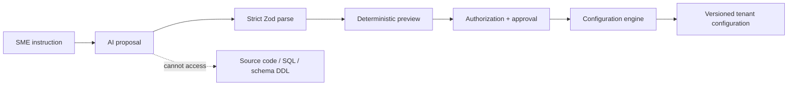

# NegosyoOS

For the consolidated product, technical, operations, audience, pricing, and marketing reference, see the [NegosyoOS Knowledge Base](docs/NEGOSYOOS-KNOWLEDGE-BASE.md).

NegosyoOS is a multi-tenant SaaS foundation for Philippine brick-and-mortar SMEs. A business chooses an industry operating-system template, enables reusable modules, and customizes operations through validated configuration.

The architectural progression is fixed:

```text
Core Platform
  → Reusable Modules
    → Industry OS Templates
      → Configuration Engine
        → AI Builder
          → AI Business Advisor
```

The AI produces configuration proposals. It never writes production source code, SQL, database migrations, or tenant-specific schemas.

## Current phase

The repository contains application code and database migrations for the core platform, industry templates, catalog/import, inventory, POS/sales, purchasing, expenses, receivables, onboarding, workflows/approvals, analytics, an evidence-backed Business Advisor, recommendations, and subscription checkout. Presence in the repository is not proof of deployed or customer-validated behavior.

The Business Advisor currently plans supported questions deterministically and composes answers from approved metrics and queries. It is not a general-purpose LLM chat implementation. The next release milestone is a single-branch retailer's journey from setup to a verified first business insight. See [the implementation audit and pilot backlog](docs/first-insight-audit.md) for evidence, known gaps, and release gates.

## Technology

- Next.js 16 App Router and strict TypeScript
- PostgreSQL through Supabase Database, Auth, Storage, and optional Realtime
- Tailwind CSS and shadcn/ui source conventions
- Zod for configuration and trust-boundary validation
- TanStack Query for client-owned asynchronous state
- npm workspaces; no monorepo build-framework dependency
- PWA-first web delivery; native mobile is deferred
- Redis/queue adapter deferred until workflow execution and scheduling require it

Node.js 22 or later is required. Dependency versions are pinned in the lockfile.

## Repository structure

```text
apps/
  web/                    # Next.js delivery layer and PWA manifest
packages/
  ai/                     # AI configuration, interviews, Advisor, and recommendations
  auth/                   # Supabase SSR clients and server authorization
  business/               # Business models, validation, tenant context, and scoped data access
  configuration/          # Configuration operation schemas and deterministic engine port
  core/                   # Platform primitives, errors, logging, API contracts, permissions
  database/               # Generated types and Supabase migrations/config
  forms/                  # Declarative form layouts, conditions, validation, and server services
  modules/                # Reusable module registry, configuration schemas, dependency graph, and services
  objects/                # Dynamic object metadata, record validation, persistence services, and pagination
  rbac/                   # Capability roles, member assignments, and Branch access services
  templates/              # Industry OS template contracts
  ui/                     # Shared shadcn/ui-style components
  workflow/               # Declarative workflow and future dispatcher contracts
docs/                     # Architectural decisions
```

This is a modular monolith: one web deployment and one PostgreSQL database, with package boundaries that can be enforced today and extracted only if measured scale or ownership needs justify it.

## The configuration boundary

The canonical configuration language is `@negosyo-os/configuration`. It models:

- objects and fields
- relationships
- views and forms
- workflows
- reports and dashboards
- role permission assignments

For “Add contractor name to quotations,” the accepted operation is:

```json
{
  "operation": "add_field",
  "objectKey": "quotation",
  "field": {
    "key": "contractor_name",
    "label": "Contractor Name",
    "type": "text"
  }
}
```

All schemas are strict. Unknown properties such as `sourceCode` or `sql` are rejected. AI output is parsed into a `ConfigurationChangeSet`, previewed against the current organization revision, authorized, approved, and only then passed to the deterministic `ConfigurationEngine.apply` boundary.



The AI package includes configuration contracts and implemented deterministic Advisor/recommendation services. Any future model adapter for configuration proposals must produce output matching `AiConfigurationProposalSchema`; it must not bypass deterministic validation or authorization.

## Package dependency direction

Allowed dependency flow:

```text
web → auth/business/rbac/modules/objects/forms/ui/core
business → auth/core/database
rbac → auth/business/core/database
auth → core/database
templates → modules/configuration
modules → auth/business/core/database
objects → auth/business/core/database
forms → auth/business/core/database/objects
ai → configuration
workflow → configuration
configuration → Zod only
database → no application package
```

Packages must import another package through its public `exports`, never through its `src` directory. Circular package dependencies are prohibited. Business modules added later may depend on configuration and core contracts but cannot modify another module's internals.

## Multi-tenancy and security

`organization_id` is the hard tenant boundary; branches are organization children. PostgreSQL RLS protects every exposed platform table, while server helpers perform explicit authentication, membership, and permission checks for clear application behavior.

Security invariants:

- Verify identity with `auth.getClaims()` rather than trusting cookie session data.
- Never authorize from user-editable `user_metadata`.
- Never expose Supabase secret/service-role keys to the browser.
- `anon` has no public-table grants.
- Tenant UPDATE policies use both `USING` and `WITH CHECK`.
- Necessary `SECURITY DEFINER` helpers live in the unexposed `private` schema, use an empty `search_path`, and derive identity from `auth.uid()`.
- Storage object keys begin with `<organization-uuid>/` and are checked by RLS.
- AI configuration cannot include credentials, code, SQL, or arbitrary executable expressions.

### Business tenant boundary

The product language is `User → Business → Branch`. Persistence retains the original `organizations` and `organization_id` names because `organization_id` is already the platform-wide hard tenant key; `@negosyo-os/business` maps those rows to camelCase `Business`, `BusinessMember`, `Branch`, and `BusinessSettings` models.

Business creation is one atomic, authenticated database operation. It creates the Business, active owner membership, owner role and permissions, one-to-one settings, and main branch together. `created_by` is audit data and grants no access by itself. All access requires an active membership plus the applicable database-backed permission.

Tenant rules:

- Business routes use `/business/[businessId]`; the server layout validates the UUID and active membership before rendering descendants.
- The HTTP-only active-business cookie is navigation state only. It is never accepted as authorization.
- Server queries live in `@negosyo-os/business/server`. A single-tenant query first authorizes the Business and then includes `.eq("organization_id", businessId)` (or `.eq("id", businessId)` for the Business row).
- RLS independently enforces the same boundary for direct Data API access.
- Tenant foreign keys are immutable after insertion, preventing records from being moved between Businesses—even by a user who administers both.
- Storage paths retain the existing `<business-uuid>/...` convention and are protected by the same membership/permission functions.

Run the dedicated adversarial RLS suite with `npm run test:db`. It authenticates as two unrelated users and attempts cross-tenant reads, updates, inserts, settings access, permission checks, and branch reassignment.

### Roles and capability permissions

Every Business receives six immutable system roles: Owner, Administrator, Manager, Cashier, Staff, and Viewer. Businesses may also create custom roles composed from the global, code-reviewed permission catalog. Authorization checks permission keys such as `sales.create` and `inventory.adjust`; application code never checks role names.

Members have either `all` Branch access or an explicit set of Branch grants. A capability with a Branch context succeeds only when the member has both the permission through one of their roles and access to that Branch. Future Branch-owned tables must pass their `branch_id` to the same database permission function in RLS.

Server code uses the reusable helper:

```ts
const allowed = await can(user, PERMISSIONS.salesCreate, {
  businessId,
  branchId,
});
```

`can(user, permission, context)` re-verifies the signed-in caller, requires the supplied user to match that caller, and asks PostgreSQL for the capability decision. It fails closed. Mutations use `requireCapability(...)` or a domain service that calls it before writing. Permission-aware UI may hide navigation, forms, or buttons, but the corresponding Server Action, RPC, and RLS policy independently enforce the same capability.

Role and member access management lives at `/business/[businessId]/roles`. System-role definitions cannot be edited; custom role permission updates and member role/Branch assignments execute atomically through validated RPCs.

### Module Registry

`ModuleDefinition` is a platform-owned reusable capability contract. Its stable `snake_case` key, category, dependencies, icon identifier, minimum plan, strict configuration schema, and positive version live in the global registry. `BusinessModule` is the tenant-owned activation state and maps the public product fields `businessId`, `moduleKey`, `enabled`, `configuration`, and `activatedAt` onto the existing `organization_modules` persistence table.

The initial registry publishes Sales, POS, Inventory, CRM, Expenses, Quotations, Invoicing, Purchasing, Appointments, Job Orders, Delivery, Employees, Attendance, and Loyalty. This is registry metadata only; operational business records and screens remain deferred to Phase 3.

Module rules:

- Configuration schemas use a constrained declarative field language and compile to strict Zod object validators. Unknown keys and invalid types or ranges are rejected.
- The database independently validates configuration at the mutation boundary, so bypassing the web form cannot install arbitrary JSON.
- Activation requires `module.manage`, an eligible subscription plan, and every declared dependency to be enabled.
- Deactivation is rejected while any enabled module depends on the target.
- State changes use a short atomic transaction and a per-Business advisory lock to serialize competing dependency changes.
- Direct Data API writes to Business module state are revoked. The narrowly granted RPC repeats authentication, capability, plan, dependency, and configuration checks.
- Registry reads require `module.read` and Business module rows remain isolated by RLS.

The registry UI lives at `/business/[businessId]/modules`. Business navigation is built from enabled `ModuleRegistryEntry` values through `buildModuleNavigation`; module links are not scattered as hardcoded layout entries. Generic module workspace routes intentionally expose only activation metadata until Phase 3 supplies operational implementations.

### Dynamic Object Builder

The Object Builder defines Business entities such as Customer, Contractor, Vehicle, Property, Job, Patient, Member, or Reservation without creating a PostgreSQL table for each entity. `ObjectDefinition`, `FieldDefinition`, and `ObjectRelationship` remain tenant-scoped metadata; all runtime `ObjectRecord` values share one RLS-protected table.

Each record keeps frequently queried system values—Business, object definition, Branch, display value, lifecycle status, actor IDs, and timestamps—in indexed columns. Configurable attributes use validated JSONB. A GIN `jsonb_path_ops` index supports containment queries, while partial composite indexes support active-object and Branch listings. Dynamic unique fields use an internal normalized projection with a database unique constraint, avoiding fragile per-tenant expression indexes or DDL.

Supported field types are `text`, `textarea`, `number`, `decimal`, `currency`, `percentage`, `boolean`, `date`, `datetime`, `email`, `phone`, `url`, `select`, `multiselect`, `status`, `user`, `branch`, `relation`, and `attachment`. Every field can declare required/unique behavior, a default value, placeholder, help text, options, validation bounds, visibility, and read-only state.

Object Builder invariants:

- Object and field keys are immutable `snake_case` identifiers; labels remain editable presentation text.
- Strict Zod validation handles every UI and service input. The database independently revalidates types, options, required/default rules, protected fields, Branches, users, relations, attachments, and unknown keys.
- Hidden and read-only fields cannot be overwritten by record forms; protected defaults are applied inside the mutation boundary.
- Relation values must reference an active record of the configured target object in the same Business.
- Archiving a field removes it from new validation while retaining its historical JSONB values on existing records.
- Record lists use `(created_at, id)` keyset pagination rather than offset pagination.
- Metadata mutations require `metadata.manage`; records use separate `record.read`, `record.create`, and `record.update` capabilities. Server services, RPCs, and RLS enforce these independently.
- Direct Data API writes to object definitions, fields, and records are revoked. Atomic functions own mutation invariants and unique-value projection updates.

UI routes:

- `/business/[businessId]/objects` — create and browse objects
- `/business/[businessId]/objects/[objectKey]/builder` — add, edit, reorder, and archive fields
- `/business/[businessId]/objects/[objectKey]` — list records
- `/business/[businessId]/objects/[objectKey]/new` and `/records/[recordId]/edit` — metadata-generated record forms

### Dynamic Forms

`FormDefinition` associates a stable form key, object, mode (`create` or `edit`), and lifecycle with one Business. `FormLayout` stores an incrementing version and ordered sections. Sections control responsive one- or two-column grouping, while field placements can strengthen required/read-only behavior, supply a type-checked default, choose full/half width, and attach a visibility rule.

Conditions are data, never executable code. The allow-listed rule language supports `equals`, `not_equals`, `is_empty`, and `is_not_empty` joined by `all` or `any`. A condition may reference only a field that appears earlier in the form. This makes evaluation deterministic, prevents circular rules, and gives the database a bounded structure it can validate. Unknown properties—including JavaScript, SQL, or expression strings—are rejected by strict Zod schemas and independently by PostgreSQL.

The same layout drives the visual designer, live preview, and runtime renderer. Submission handling does not trust browser visibility, required attributes, disabled controls, or hidden inputs. The Server Action reloads the tenant-owned form and current field definitions, evaluates conditions again, rejects unknown/hidden/read-only injection, merges omitted edit values, validates every effective value against its `FieldDefinition`, and then delegates to the existing capability-protected record mutation boundary. PostgreSQL repeats object-level type, relation, Branch, user, uniqueness, and tenant checks.

Form security and persistence rules:

- `form.read` controls use and discovery; `form.manage` controls the designer and atomic metadata saves.
- Form and layout tables have tenant-composite foreign keys, RLS, explicit read grants, and no direct authenticated writes.
- Form object/key and layout parent relationships are immutable; updates increment the layout version.
- Active form lookup uses a partial composite index keyed by Business, object, mode, and name.
- Create layouts must contain object-required writable fields unless the object supplies a protected default.

### Module 8 — Configurable Views

`ViewDefinition` is tenant-scoped metadata over one Object Definition. It selects a `table`, `cards`, or `kanban` layout and declares columns, a bounded filter group, ordered sort rules, optional grouping, reusable named filters, searchable fields, page size, and Branch filtering. Personal views are visible only to their owner; shared views are visible to members who can read the underlying records and require metadata-management permission to create or change.

The reusable `ViewRenderer` receives a definition plus the deterministic runtime result. All three layouts therefore share filtering, search, sorting, grouping, Branch scope, and pagination behavior rather than implementing separate object pages. Common operational views such as **Unpaid Contractor Accounts**, **Pending Deliveries**, **Low Stock Products**, and **Today's Appointments** are configuration values: they require no new React page component.

Filter operators are an allow-listed AST validated by strict Zod schemas. Saved definitions cannot contain SQL, JavaScript, or expressions. Runtime record reads remain protected by the existing tenant and Branch-aware RLS policies.

### Module 9 — Declarative Workflow Engine

`WorkflowDefinition` stores a versioned **Trigger → Conditions → Actions** graph. Initial triggers are `record.created`, `record.updated`, `record.status_changed`, `schedule`, and `manual`. Conditions and actions are strict discriminated metadata schemas; unknown properties, JavaScript, SQL, and expression strings are rejected. The visual editor builds the same JSON contract used by the runtime.

Each run creates one idempotent `WorkflowExecution` and ordered `WorkflowExecutionStep` logs. Successful steps are not replayed during retries, terminal failures retain a safe error code/message, and retry attempts plus next-run timestamps follow the definition’s bounded retry policy. Test runs evaluate the trigger and conditions and validate each action without applying side effects. Definition changes, enable/disable events, tests, and retries are retained in immutable audit history.

Record saves dispatch matching active workflows after the Object Builder commits. Scheduled workflows use a five-part cron matcher in the Business timezone and expose a dispatcher port for the future distributed scheduler. Business mutations still pass through Object Builder validation and RBAC. Notifications, approval requests, and tasks are stored as tenant-scoped workflow artifacts.

UI routes:

- `/business/[businessId]/objects/[objectKey]/forms` — browse forms
- `/forms/new` and `/forms/[formKey]/builder` — create and visually design layouts with live preview
- `/forms/[formKey]/use` — render a create-mode form
- `/forms/[formKey]/records/[recordId]` — render an edit-mode form

TypeScript names use product language and camelCase (`businessId`, `defaultValue`, `readOnly`). PostgreSQL uses lowercase snake_case (`organization_id`, `object_definition_id`); metadata JSON keys use the stable field key exactly.

## Authentication

Supabase Auth owns credentials, email verification, password recovery, refresh-token rotation, and cookie-backed sessions. Next.js Proxy refreshes sessions and provides an optimistic redirect for `/dashboard` and `/account`; it is not an authorization boundary. Protected Server Components, Server Actions, and Route Handlers independently call `auth.getClaims()` through `@negosyo-os/auth` before accessing data or mutating state.

Implemented routes:

- `/signup`, `/login`, and `/forgot-password`
- `/auth/confirm` for token-hash email verification
- `/auth/callback` for PKCE password recovery and future OAuth providers
- `/account` and `/account/password`, protected on both the routing and server-data layers

The application exposes only a minimal `{ id, email? }` identity derived from verified claims. It never returns access tokens, refresh tokens, provider identities, raw Supabase user objects, or user metadata. Authentication failures shown to users are deliberately generic, and password-reset responses do not reveal whether an email is registered.

For a hosted Supabase project:

1. Set the Site URL to the exact HTTPS value used by `APP_URL`.
2. Allow `${APP_URL}/auth/confirm` and `${APP_URL}/auth/callback` in Auth redirect URLs.
3. Require email confirmation and configure a minimum 12-character password with letters and digits.
4. Change the **Confirm signup** email link to `{{ .SiteURL }}/auth/confirm?token_hash={{ .TokenHash }}&type=email`.
5. Configure production SMTP and review Auth email/rate limits before launch.

Google and Facebook are represented by an allow-listed provider schema; mobile OTP uses an E.164 input contract. Their provider credentials and UI remain disabled until those providers are configured and approved. They will reuse `/auth/callback`; no provider secret belongs in browser environment variables.

## Local development

Docker Desktop is required for local Supabase.

```powershell
npm install
Copy-Item apps/web/.env.example apps/web/.env.local
npm run db:start
npm run db:reset
npm run dev
```

Set `APP_URL` to the canonical application origin. HTTP is accepted only for `localhost` or `127.0.0.1`; deployed environments require HTTPS. Keep the Supabase publishable key in the browser-safe variable shown in `.env.example` and never add a secret/service-role key to the web application.

Use the publishable key printed by `supabase start`. The local stack is development-only and must not be exposed publicly.

After a migration:

```powershell
npm run db:reset
npm run db:types
```

Quality suite:

```powershell
npm run lint
npm run typecheck
npm test
npm run test:db
npm run build
```

## Build sequence

1. **Foundation** — tenancy, RBAC, packages, migrations, observability, API contracts, PWA shell.
2. **Configuration Engine** — versioned configuration persistence, preview/diff, validation, audit, transactional application, rollback semantics.
3. **Core SME Modules** — only after the engine can safely install and evolve module configuration.
4. **Industry OS Templates** — compose published module versions plus baseline configuration.
5. **AI System Builder** — OpenAI adapter constrained to configuration proposal schemas.
6. **45-Day Trial Funnel** — lifecycle, entitlements, onboarding, measurement, conversion.
7. **AI Business Advisor** — evidence-backed recommendations built on trustworthy reports.
8. **Integrations and Marketplace** — signed adapters, module distribution, and governance.

The AI builder is intentionally not implemented before the configuration engine.

## Database model

The database establishes identity, organizations, branches, memberships, RBAC, reusable module definitions and dependencies, tenant module activations, Business OS templates, metadata definitions, shared dynamic object records, workflows, reports, dashboards, AI settings, subscriptions, and private organization asset storage. No tenant-specific or industry-specific tables are generated.

Types in `packages/database/src/database.types.ts` are generated from the migrated local database. Create migrations with `supabase migration new` from the database package work directory; do not handcraft timestamp names.

## API, errors, and logging

Route handlers use a stable `{ ok, data|error, meta.requestId }` envelope and return `x-request-id`. Expected failures use `AppError`; unknown exceptions become generic 500 responses. The structured logger redacts password, token, secret, cookie, authorization, and API-key fields.

Use `logger.child({ domain, operation })` and include stable request, organization, and entity identifiers—never raw credentials or request bodies.

See [docs/architecture-decisions.md](docs/architecture-decisions.md) for the decision record.
